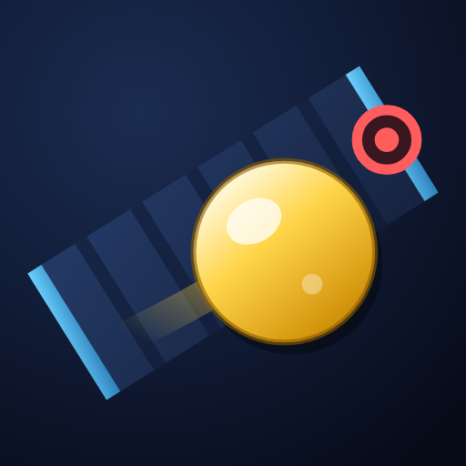

# 赛球 · 上线资料（复制即用）

在 [微信公众平台](https://mp.weixin.qq.com) 注册**小游戏**账号后，按下面内容填写。
数值以平台后台当时的提示为准。

---

## 一、名称

**主推：`赛球弹珠竞速`**（6 个汉字 = 12 字符）

备选（按优先级）：

| 名称 | 说明 |
|---|---|
| `赛球MarbleRush` | 中英结合，辨识度高 |
| `弹珠赛球` | 更短，好记 |
| `赛球大冲刺` | 突出竞速感 |

注意事项：
- 长度 4~30 字符（1 个汉字 = 2 字符），**全平台唯一**，后台会实时查重
- 不要只填 `赛球` 两个字：太短且偏通用词，容易被判定缺乏识别性而驳回
- 发布前可修改 2 次，发布后个人主体每年 2 次，名字想好再定

## 二、简称（选填）

`赛球`（4 字符，从名称中截取，允许重名）

## 三、简介

**主推（约 60 字）：**

> 上帝视角弹珠竞速小游戏：操控弹珠冲下机关赛道，闪避旋转风车、活塞与陷阱黑洞，与 AI 对手争夺冠军。支持单人、双人分屏与全 AI 观赛，赛道长度与难度自由组合。

**短版（约 38 字）：**

> 上帝视角弹珠竞速：冲下机关赛道，闪避风车、活塞与黑洞，与 AI 对手争夺冠军。

注意事项：
- 长度 4~120 字符；内容必须与实际功能一致（审核会对照游戏内容）
- 目前**不要写"好友对战/联机"**——邀请对战尚未开发，写了会因功能不符被驳回
- 不要使用"最""第一""国家级"等广告法禁用词

## 四、头像

  
  

左：高清版 512×512　·　右：上传版 144×144

文件在 `weapp/assets/`：

| 文件 | 用途 |
|---|---|
| `icon-144.png` | **上传用**（144×144，PNG，约 15KB） |
| `icon-512.png` | 高清备用（宣传图、商店素材） |
| `icon-source.html` | 图标源文件（SVG），改配色后可用浏览器截图重新生成 |

设计要求：
- 144×144，PNG/JPG，小于 2MB
- **四边直角，不要自己做圆角**（平台会自动裁圆，自带圆角会被驳回）
- 图案清晰、主体居中，缩到小尺寸仍能看清

## 五、服务类目

| 层级 | 选择 |
|---|---|
| 一级类目 | **游戏**（注册时勾选，之后不可更换/删除，选错只能重新注册） |
| 二级类目 | **休闲** |
| 三级类目 | **竞速** |

理由：玩法是弹珠沿赛道竞速闯关，没有牌类、角色养成、文化互动内容。若后台三级列表里没有"竞速"，选"休闲"下最接近的选项或"其他"。

限制：
- 个人主体**不能选**文化互动、角色类、牌类
- 二级类目发布后不可修改；三级类目可在资质管理中修改，但需重新审核并发布新版本
- 类目必须与实际内容相符，否则提审被驳回

## 六、其它必填项

| 项目 | 建议 |
|---|---|
| 适龄提示 | **8+**（无血腥暴力、无付费抽卡） |
| 隐私协议 | 目前仅本地存储，不收集用户信息；若后续加好友对战、登录，需补充隐私协议 |
| ICP 备案 | 新注册的小程序/小游戏必须完成备案才能上线（公众平台内提交） |
| 游戏自审自查 | 按平台要求完成并保留记录 |

## 七、提审：游戏内容说明（表单文案）

提审时「游戏内容说明」页要填场景、玩法，并上传截图。可直接复制下面内容。

### 1. 各主要场景描述（要求 ≥30 字，上限 800 字）

> 游戏主界面为深蓝色科幻风格：顶部是渐变金色的「赛球」标题，下方依次排列模式（单人／双人分屏／全 AI 观赛）、赛道长度、AI 难度、小球数量、选手命名等选项，按钮采用深蓝底配金色与青色霓虹描边。
> 游玩界面为上帝视角的纵向赛道：赛道两侧是金属蓝护墙，赛道内分布石门关隘、错位石门阵、旋转风车、墙边摆锤、来回活塞、弹射台、钉阵、漏斗与黑色陷阱洞等机关；金色、红色、蓝色等十色弹珠拖着光尾高速下冲，顶部显示实时战况条与实时排名面板，底部为虚拟摇杆或左右方向按钮。
> 结算界面为半透明深色面板，用奖牌图标列出名次、选手、用时与落坑次数，并提供再来一局／换新赛道／返回菜单三个按钮。

### 2. 具体玩法为（要求 ≥50 字）

> 玩家操控一颗弹珠从赛道起点出发，通过左右转向（触屏可用虚拟摇杆，也可在设置中切换为左右方向按钮）避开机关与陷阱洞，并在与其他弹珠的碰撞中抢占路线，最先冲过终点者获胜。赛道全程实时物理碰撞，被机关弹开或撞到对手会改变速度和方向，掉入陷阱洞后会短暂下坠并在下方重新出现，落坑次数会记录在成绩里。游戏提供单人（对战 AI）、双人分屏（同一设备两人各控一颗）、全 AI 观赛三种模式；赛道长度（约 40 秒至 3 分钟）、AI 难度（简单／普通／困难／噩梦）、参赛小球数量（1-10 颗）均可自由组合。每局结束后显示名次、用时与落坑次数，最佳成绩自动保存在本机。手机端可在设置中调节音效音量与静音。

### 3. 主背景描述（要求 ≥30 字，上限 800 字）

> 《赛球弹珠竞速》没有复杂的剧情线，世界观设定在一座由远古机关构成的弹珠竞技场：十颗颜色各异、来自不同阵营的弹珠选手，沿着由石门、风车、摆锤、活塞与陷阱黑洞组成的超长赛道一路下冲，在碰撞与闪避中争夺冠军。游戏以科幻竞技为主题，主界面采用深蓝星空配金色与青色霓虹的视觉风格，赛道以金属蓝护墙和发光机关呈现未来感；整体氛围轻松明快，没有血腥暴力、恐怖或赌博元素。

配图（该模块要求 ≥3 张，用不同的场景图）：`start.png`（起点）、`obstacles.png`（机关赛道）、`finish.png`（终点）。

### 4. 系统功能

⚠️ 表单里的「系统1」默认是**货币系统**，但赛球**没有**金币、钻石、商城、充值、兑换码、会员、道具购买等任何商业化系统。不要保留「货币系统」，否则描述与游戏内容不符会被驳回。

处理方式二选一：

- 下拉里如果有「**其他系统**」→ 选它，说明填下面这段
- 下拉里没有合适的 → 点右侧「**删除系统**」，系统2 保持「请选择」不动

系统1说明（选择「其他系统」时填）：

> 本游戏不包含货币、商城、充值、兑换码、会员/VIP、付费道具、红包或广告等任何商业化系统，所有玩法内容免费开放。仅有两项本地功能：①成绩记录——每局结束后展示名次、用时与落坑次数，并在本机保存不同赛道长度与难度组合下的最佳成绩；②设置保存——操作方式（虚拟摇杆／左右按钮）与音效音量保存在本机。所有数据仅存储在玩家设备本地，不上传服务器，不涉及任何交易与付费。

系统1截图（要求 ≥1 张）：用 `results-second.png`（08-结算-第2名，能同时看到成绩表与最佳成绩）。

#### 系统2 / 系统3 怎么填

**首选：删除或留空。** 赛球是纯单机休闲游戏，没有商城、充值、会员、道具、红包、抽奖、广告、账号或联网排行榜，系统1 已经把仅有的两项本地功能写清楚了，系统2/3 就没有需要申报的内容。点「删除系统」，或保持「请选择」不填即可 —— 不存在的系统不要编，编了反而会因“描述与游戏内容不符”被驳回。

**如果表单强制要求至少选一项**（下拉里没有「其他系统」时），按实际功能二选一，不要选货币/商城/充值/会员/道具/红包/广告：

| 可选方向 | 适用说明 |
|---|---|
| 排行榜 / 成绩系统 | 对应“本地最佳成绩”，说明必须强调是**单机本地记录**，不是联网排行榜 |
| 设置 / 其他系统 | 对应“操作方式与音效设置”，说明仅保存在本机 |

系统2 填「排行榜系统」时可用：

> 游戏不含联网排行榜、账号体系与排名奖励。每局结束后在结算界面显示本局名次、用时与落坑次数；玩家在本机的不同赛道长度与难度组合下分别保存最佳成绩，仅在本地读取与展示，不上传服务器、不涉及付费与交易。

系统2 填「设置系统」时可用：

> 玩家可在设置中切换操作方式（虚拟摇杆／左右方向按钮），并调节音效音量、开关静音。设置内容仅保存在玩家设备本地，不涉及账号信息、付费与任何用户数据上传。

系统2 截图（要求 ≥1 张）：用 `settings.png`（07-设置面板，能看到操作方式、音量条与静音开关）。

系统3：同上处理，一般直接删除或留空。

### 5. 相关截图（要求 ≥3 张，JPG/JPEG/PNG，60KB–5MB）

已生成 **12 张**，放在 `weapp/assets/screenshots/`（也复制到了 `C:\Users\qq319\Documents\赛球截图\`）。
**每个模块的上传位用不同图片**，按下表对应：

| 文件（文档中的编号） | 用在哪个模块 | 画面 |
|---|---|---|
| `menu.png`（01-场景-主界面） | 场景 1/3 | 主菜单：名称、模式、赛道、难度、小球数量、命名、开始比赛、设置 |
| `gameplay.png`（02-场景-游玩界面） | 场景 2/3 | 比赛中：实时排名、战况条、机关赛道、弹珠、虚拟摇杆 |
| `results.png`（03-场景-结算冠军） | 场景 3/3 | 冠军结算：名次、用时、落坑、再来一局 |
| `play-2p.png`（04-玩法-双人分屏） | 玩法 1/3 | 双人分屏：左右两个视角、P1/P2 各一组摇杆 |
| `play-spectate.png`（05-玩法-全AI观赛） | 玩法 2/3 | 全 AI 观赛：观赛视角、实时排名、切换提示 |
| `play-buttons.png`（06-玩法-左右按钮） | 玩法 3/3 | 左右按钮操作：屏幕下方 ◀ ▶ 转向键 |
| `start.png`（07-背景-起点） | 主背景描述 1/3 | 起点出发：斑马线、多颗弹珠、初始排名 |
| `obstacles.png`（08-背景-机关赛道） | 主背景描述 2/3 | 赛道中段：旋转风车、陷阱黑洞、钉阵、弹珠缠斗 |
| `finish.png`（09-背景-终点） | 主背景描述 3/3 | 终点冲刺：终点线、剩余距离、名次 |
| `menu-best.png`（10-系统1-其他-最佳成绩） | 系统1「其他系统」 | 主菜单底部显示本机最佳成绩 + 设置入口 |
| `results-second.png`（11-系统2-排行榜-结算） | 系统2「排行榜系统」 | 亚军结算：完整成绩表、落坑次数、最佳成绩 |
| `settings.png`（12-系统3-设置面板） | 系统3「设置系统」 | 操作方式（摇杆/按钮）、音效音量、静音、试听 |

12 张均为 1290×2796，画面内都有游戏名「赛球弹珠竞速」；大小约 390–710KB，均在 60KB–5MB 区间。

⚠️ **重要说明**：这 12 张是**游戏本体按手机尺寸（430×932）真实渲染**的截图，画面与移植后的微信小游戏一致；但严格意义上**不是"微信内运行"的截图**。移植完成后，建议用真机在微信里重新截同样的 12 个画面替换，以完全满足「需使用微信游戏截图」的要求。

注意事项：
- 截图要包含主界面、游玩界面、结算界面各一张，共至少 3 张
- 用真机在微信里打开小游戏后截图最稳妥（开发者工具模拟器截图可能不被接受）
- 游戏内标题已改为「赛球弹珠竞速」，与注册名一致（若最终注册名不是这个，记得同步修改 `index.html` 的 `.title`）

## 八、提交前检查

- [ ] 名称已定、未与他人重名
- [ ] 简介不夸大、不写没做的功能
- [ ] 头像为直角方形 144×144
- [ ] 类目：游戏 > 休闲 > 竞速
- [ ] 已填 AppID 到 `weapp/project.config.json`
- [ ] 已完成 ICP 备案
- [ ] 微信认证（个人主体可选，部分能力需要）

---

> 平台规则会更新，最终以微信公众平台后台提示和审核指南为准。
