# 赛球弹珠竞速游戏软件 V1.0.0 使用说明书

**软件名称：** 赛球弹珠竞速游戏软件
**版本号：** V1.0.0
**开发完成日期：** 2026 年 10 月 26 日
**开发语言：** JavaScript（ES6+）、HTML5 Canvas
**运行平台：** 微信小游戏（微信客户端）

## 一、软件概述

《赛球弹珠竞速游戏软件》是一款上帝视角的弹珠障碍竞速游戏。玩家操控一颗弹珠从赛道起点出发，沿纵向赛道高速下冲，通过左右转向闪避旋转风车、墙边摆锤、来回活塞、弹射台、钉阵、漏斗与陷阱黑洞等机关，并在与其他弹珠的碰撞中抢占路线，最先冲过终点者获胜。

游戏提供单人、双人分屏、全 AI 观赛三种模式；赛道长度（约 40 秒至 3 分钟）、AI 难度（简单／普通／困难／噩梦）、参赛小球数量（1–10 颗）均可自由组合。每局结束后显示名次、用时与落坑次数，并在本机保存最佳成绩。

## 二、运行环境

### 2.1 硬件环境

- 智能手机（iOS 或 Android），运行内存 2GB 及以上
- 支持横竖屏显示，推荐竖屏使用

### 2.2 软件环境

- 微信客户端，微信小游戏基础库 2.19.0 及以上
- 或现代浏览器（Chrome、Edge、Safari 等）运行 H5 版本

### 2.3 网络环境

游戏为单机运行，无需联网；音效与设置、成绩等数据全部保存在本机。

## 三、安装与启动

### 3.1 微信小游戏

1. 在微信中打开本小游戏（搜索名称或点击分享卡片）。
2. 首次进入会自动加载游戏资源，约 1–2 秒。
3. 进入主界面即可看到游戏标题与各项设置。

### 3.2 开发者工具（测试用）

1. 打开微信开发者工具，选择「小游戏」→「导入项目」。
2. 选择工程目录，AppID 使用测试号或正式 AppID。
3. 点击「编译」，模拟器中即显示主界面。

## 四、主界面说明

主界面由标题区、简介区、模式选择、赛道长度、AI 难度、小球数量、选手命名、开始按钮与设置入口组成。

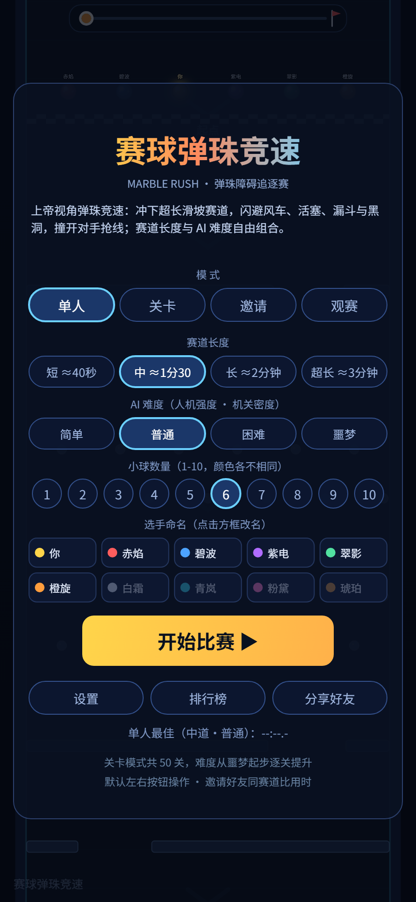

| 区域 | 说明 |
|---|---|
| 标题区 | 显示游戏名称「赛球弹珠竞速」 |
| 模式 | 单人 / 双人·分屏 / 全AI观赛 |
| 赛道长度 | 短（约 40 秒）/ 中（约 1 分 30）/ 长（约 2 分钟）/ 超长（约 3 分钟） |
| AI 难度 | 简单 / 普通 / 困难 / 噩梦，同时影响人机强度与机关密度 |
| 小球数量 | 1–10 颗可选，十种颜色各不相同 |
| 选手命名 | 点击方框可修改名字，每个最多 6 个字符，自动保存在本机 |
| 开始比赛 | 按当前选项开始一局 |
| 设置 | 进入设置面板，调整操作方式与音效 |

主界面底部显示当前赛道长度与难度组合下的最佳成绩。

## 五、模式说明

### 5.1 单人模式

玩家（金色弹珠）与若干 AI 弹珠同场竞速。玩家从中间赛道位置出发，其余位置由 AI 填充，AI 强度按难度从强到弱分布。

### 5.2 双人分屏

两名玩家在同一台设备上游玩，屏幕左右分屏，各自拥有独立视角与控制区。P1 位于左侧，P2 位于右侧；同一局中两边共享同一条赛道与同一批机关。

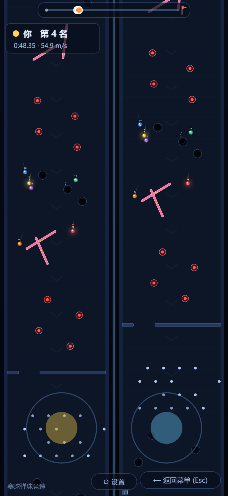

### 5.3 全 AI 观赛

所有弹珠均由 AI 控制，玩家以观赛视角观看比赛。可点击右侧实时排名或顶部战况条切换跟随的弹珠。

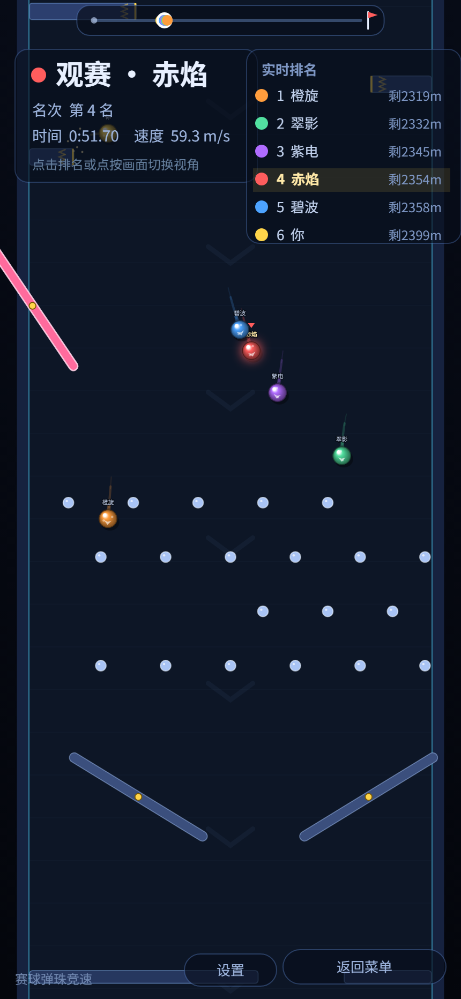

## 六、比赛操作

### 6.1 虚拟摇杆（默认）

屏幕左下角显示虚拟摇杆。左右推动控制转向，推得越满转向越急；向上推动为刹车。双人模式下，右下角出现第二根摇杆供 P2 使用。

### 6.2 左右按钮

可在设置中切换为左右按钮模式。屏幕下方左侧为「◀」左转键，右侧为「▶」右转键；双人模式下 P1 使用左半边按钮，P2 使用右半边按钮，两组按钮相互独立、支持同时按压。

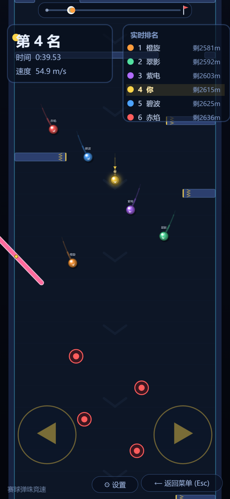

### 6.3 多点触控

摇杆与按钮均按触点独立记录，支持一边转向一边操作其他按键。长按按钮不会触发系统文本选择或长按菜单。

### 6.4 比赛中界面

比赛界面顶部为赛道战况条（显示所有弹珠在整条赛道上的位置），左上为当前名次、用时与速度，右上为实时排名，底部为「设置」与「返回菜单」按钮。

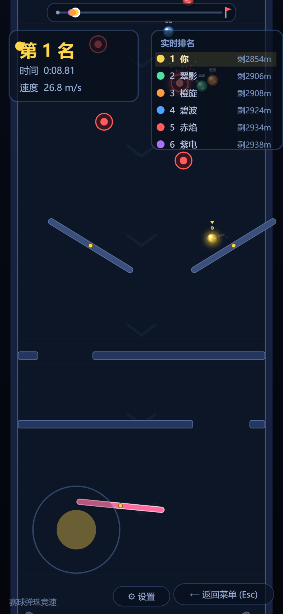

## 七、赛道与机关

赛道由程序随机生成，机关沿赛道均匀分布，生成算法保证每一排障碍都留有可通行缺口。主要机关包括：

| 机关 | 说明 |
|---|---|
| 石门关隘 | 横跨赛道的带缺口挡板 |
| 错位石门阵 | 连续两道缺口左右交替，强制 S 形走线 |
| 旋转风车 | 绕中心旋转的长杆，会击飞弹珠 |
| 墙边摆锤 | 以墙边为轴往复摆动的长杆 |
| 来回活塞 | 从左右墙面伸缩的挡板 |
| 弹射台 | 击中后强力弹开的圆形装置 |
| 钉阵 | 密集小圆柱阵列 |
| 漏斗 | 两侧斜杆收窄通道 |
| 陷阱黑洞 | 落入后短暂下坠，并在下方重新出现，落坑次数计 1 次 |

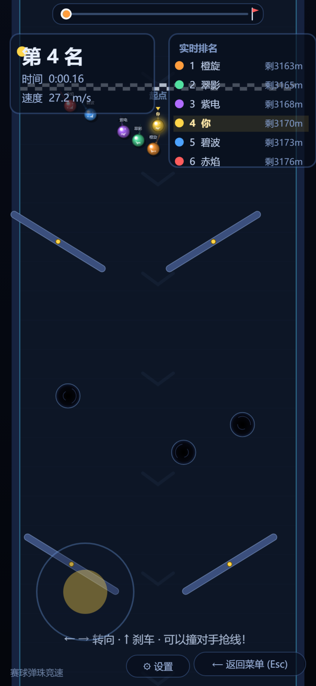

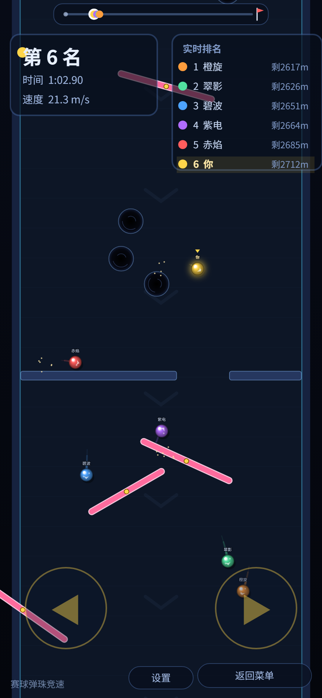

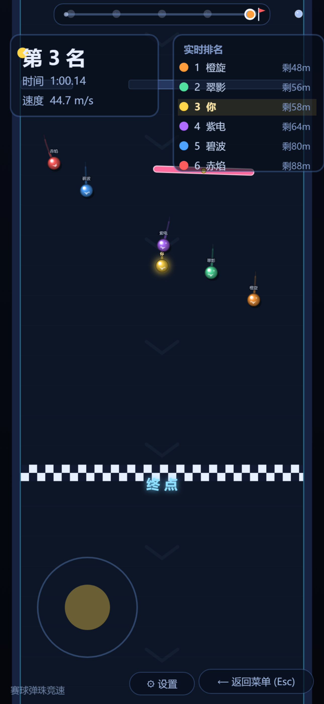

## 八、结算与成绩

一局结束后弹出结算面板，显示本局名次、冠军提示、各选手用时与落坑次数。玩家所在行会高亮显示。

- 单人模式：显示"冠军"或"第 N 名"，并把本次用时与历史最佳比较，更优则更新最佳成绩。
- 双人模式：显示两位玩家各自名次，以及是否击败所有 AI。
- 全 AI 观赛：显示夺冠弹珠名称，可再来一局或换新赛道。

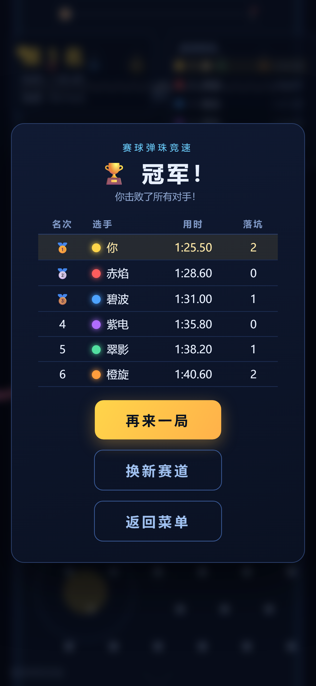

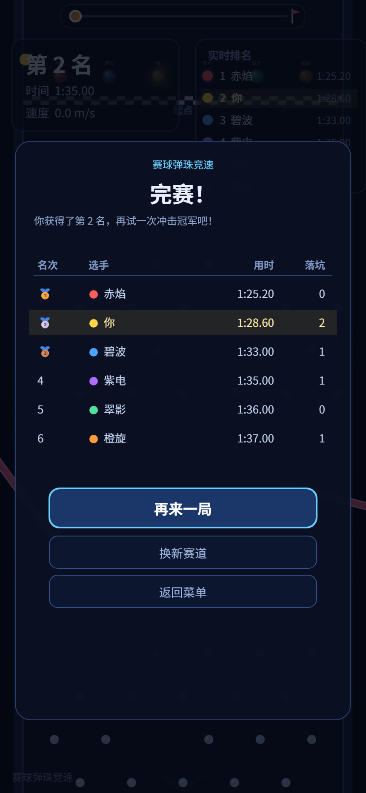

最佳成绩按「赛道长度 + AI 难度」组合分别记录，仅保存在本机，不上传服务器。

## 九、设置

点击主界面「设置」或比赛中底部「设置」按钮进入设置面板。比赛中打开设置会暂停比赛。

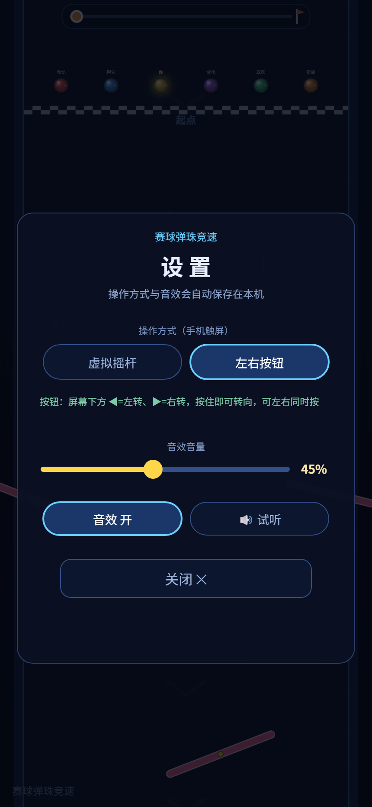

| 设置项 | 说明 |
|---|---|
| 操作方式 | 虚拟摇杆 / 左右按钮，可随时切换 |
| 音效音量 | 0–100% 拖动调节，实时生效 |
| 音效开关 | 一键静音 / 取消静音，与 M 键等效 |
| 试听 | 播放一次提示音，确认音量是否合适 |

设置保存在本机，下次打开自动恢复。

## 十、音效说明

游戏音效由 WebAudio 振荡器实时合成，包括：碰撞声、弹射台声、落坑声、倒计时提示音、发车提示音与完赛音效。不使用任何音频文件，不占用额外下载流量。

## 十一、数据与隐私

- 游戏无需登录、无需授权，不采集手机号、位置、通讯录等任何个人信息。
- 仅在本机保存：选手昵称（≤6 字符）、最佳成绩、操作方式与音量设置。
- 以上数据不上传服务器、不向第三方共享。
- 游戏内不含任何广告位、支付入口与外部跳转。

## 十二、常见问题

**Q1：没有声音？**
检查设置中的「音效」是否为开启状态、音量是否大于 0；同时确认手机未处于静音模式。

**Q2：双人模式下按钮点不到？**
双人模式左右两组按钮各自独立，P1 在左半边、P2 在右半边；建议横屏游玩以获得更大操作区域。

**Q3：换了赛道长度后最佳成绩变空了？**
最佳成绩按「赛道长度 + AI 难度」组合分别记录，切换组合后显示的是该组合下的最佳成绩。

**Q4：落坑后会怎样？**
弹珠会短暂下坠，然后在陷阱下方重新出现，落坑次数加 1，不影响继续比赛。

**Q5：游戏卡顿？**
建议关闭后台其他应用；超长赛道 + 双人分屏对性能要求最高，可根据设备情况选择较短的赛道。

---

**文档结束**
